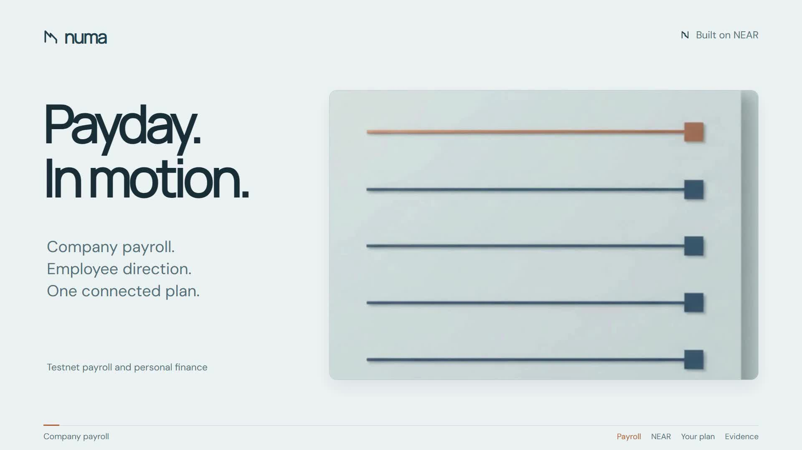

# numa 3.1

Built at **NEAR HACKATHON 2026**. Public source: [Huntrackers/numa](https://github.com/Huntrackers/numa).
Start with the [English reviewer packet](docs/submission/README.md),
[testnet operations guide](docs/submission/OPERATIONS.md),
[verification evidence](docs/submission/VERIFICATION.md) and
[submission checklist / demo draft](docs/submission/SUBMISSION.md).

Company payroll and employee savings on NEAR testnet, with a public product landing, self-serve company setup, a separate personal-finance simulation book and signed, read-only NEAR Intents route previews. English product interface; [Persian 3.1 handoff](docs/v3/HANDOFF_V31.fa.md).

## Product film

[](numa-product-film-v2.mp4)

[Watch / download the English MP4](https://github.com/Huntrackers/numa/raw/refs/heads/main/numa-product-film-v2.mp4) — 90 seconds, 1080p, with actual application captures, Gemini-generated motion and original music.

The film labels fictional demoUSD separately from native NEAR testnet settlement and historical receipts. NEAR Intents quotes use `dry: true` and move no funds. DCA fills, investing, lending and Flexible Payday economics shown are simulations, not live financial execution or guaranteed returns. The [recorded reviewer walkthrough](docs/submission/media/numa-demo.webm) remains available as additional evidence.

**Problem:** a company needs repeatable payroll without giving an automated executor unrestricted treasury access. An employee wants to assign part of every payday to a savings goal, then inspect what happened.

**Working implementation:** a Rust NEAR vault reserves a bounded payroll window, checks due dates and credits each obligation once. Savings are allocated in the same contract call. A restricted function-call key can invoke only `execute_due` on that vault. Humans authorize mandates and employee withdrawals. The API and worker additionally check the reviewed contract code hash before dispatch.

## Try it without a key or paid service

Prerequisites: Node.js **24** and npm. SQLite is provided by Node. The browser suite uses installed Chrome on Windows or Playwright Chromium on other platforms. Run `npx playwright install chromium` if needed, or set `CHROME_PATH` to an installed Chromium executable. Rust is needed only for native contract tests.

```sh
npm ci
npm run build
npm run judge
```

Open **http://127.0.0.1:4313/trust**. This command creates a separate temporary database, enables labelled sample personas and runs only the demoUSD planning worker. It does not load a testnet executor key or reuse the payroll database. Stop with Ctrl+C. Restarting creates a fresh fixture workspace. No API key, wallet, mainnet funds or hosted model is required. Public RPC and 1Click requests need internet and can be unavailable or rate-limited.

### Do this, see this

| Action | Visible result | Boundary |
|---|---|---|
| Open Execution evidence | Contract hash, finalized block, capability labels and recorded testnet receipts | Live RPC when configured; worker telemetry may be unavailable in the isolated workspace |
| Open Execution policy lab | One allowed and eight blocked scenarios using the shared evaluator | Synthetic, unsigned policy drills; no live attacks |
| Open Live route preview; choose USDC on Base to USDC on NEAR; use documented sample addresses; request preview | Provider signature verification, exact output, minimum output, fees and expiry | Real mainnet market data, forced dry mode, zero transfers |
| In company Treasury or employee Destinations / Salary allocation / DCA / Invest, expand the NEAR Intents preview | The same verified live quote without leaving the workspace | No treasury credit, salary debit or investment execution |
| Open /login; choose company persona; inspect People, Job roles and Payroll | Preview and authorize the accelerated fixture payroll; see worker credits | Fictional demoUSD, not a testnet transaction |
| Choose employee persona; set a goal and salary allocation | Decision preview and a saved allocation; inspect DCA and borrowing scenarios | Independent simulated planning book |
| Choose operator persona; inspect companies, automation and audit | Tenant status and operational controls; no withdrawal authority | Fixture operator access only |

For a real testnet company-to-employee journey, use the normal application below. [Demo walkthrough and video instructions](docs/hackathon-2026/DEMO_AND_SUBMISSION.fa.md) distinguish fixtures from live evidence.

## Run the actual testnet application

1. Copy `.env.example` to `.env`. Keep `DEMO_ENABLED=false`, network testnet and host loopback. Configure your deployed contract or use the public reviewed deployment below. Never publish this file.
2. Run `npm run build`, then `npm start` and `npm run worker` in separate terminals. On this Windows installation, `START_NUMA.cmd` manages both. Open **http://127.0.0.1:4310**.
3. Open the public landing and choose company setup or the employee workspace. Connect Meteor on NEAR testnet and verify identity using NEP-413. `/workspaces` lists only your authorized companies. Create a company and sign its NEAR registration; interrupted setup resumes the same draft company. Create a job role and invitation for a second testnet identity. The employee opens that link and accepts with the exact invited account. Invitation details are hidden from mismatched accounts.
4. Fund with native testNEAR. Review and sign a bounded daily, weekly or monthly payroll mandate. Configure a dedicated executor with `npm run testnet:secure-executor` only after reviewing [the setup guide](docs/START_HERE.fa.md). Keep its private key outside source control. Without this key, no automatic testnet payday is sent.
5. As the employee, set a savings policy, inspect the settled payday, independently claim an eligible payment or withdraw. Follow finalized receipts, cash and reserved goals in the interface.

The existing reviewed deployment is `noma-vault-mw4ab6ev.testnet`. Reviewed NEAR code hash: `EM4NqrNoxHhDHQkPvVzxvwgrTkjt8mNjHduQqNUHoyvW`. For a different deployment, obtain its finalized code hash and set `NEAR_EXPECTED_CODE_HASH` only after reviewing its source. Unpinned automated execution is blocked; an unpinned human path is explicitly warned. A mismatched pin blocks dispatch. Off-chain checks do not remove deployment-key or upgrade timing risk.

## What is real, and what is simulated

### Identity approval and settlement

Sensitive local changes (job roles, company settings, invitations, access changes, operator configuration and confirmed simulation decisions) require a fresh NEAR NEP-413 message signature. The server binds that signature to the current session, account, domain, exact input, reviewed decision state, expiry, one-time nonce and idempotency key. The review dialog shows the signed message before Meteor opens. Cancellation changes no record. A retry of an already applied request returns its original result. Inspect your private signed decision history under NEAR testnet.

Messages use no gas and do not move funds. Actual company registration, payroll mandates, claims, savings policies and withdrawals require separate NEAR transactions and independently verified finalized receipts. Read-only previews, navigation, exports, marking notifications read and sign-out do not require a financial signature. Demo personas remain unsigned fixtures only in the isolated judge mode.

| Capability | Status |
|---|---|
| Company/employee acceptance, funded payroll mandates, due-date and duplicate checks, employee cash and savings, claims and withdrawals | Real NEAR testnet contract using native testNEAR |
| Finalized event reconciliation and operational double-entry journal | Local verified projection of testnet data |
| 1Click token catalog and signature-verified route preview | Live read-only; `dry:true` is hard-coded; no wet quote, deposit address, intent signing or broadcast path |
| DCA fills, investment/stock/ETF trades, Earn, loans and Flexible Payday | Explicit demoUSD simulation; not market execution or financial returns |
| Multi-network destinations | Address-format validation and preferences; no proof of ownership or unified real balances |
| Payroll assistant | Typed, server-validated proposals; optional local Ollama explanation, no model signing tools |
| Gas sponsorship | Executor pays gas for its scheduled testnet calls; interactive wallet actions still need gas; no NEP-366 gasless claim |

There is no fabricated exchange rate between testNEAR and demoUSD. No NEAR AI Cloud, TEE, Chain Signatures, real Rhea loan or mainnet settlement is claimed. The product is a local testnet release, not a public production deployment or an independently audited financial service.

## Reproduce the verification

```sh
npm run doctor
npm run verify
# Add the full browser and native contract suites:
npm run verify -- --browser --contract
```

The verifier records each command, exit code, duration, logs and a source digest in `artifacts/verification.json`. A skipped suite is never counted as passed. The default profile includes the real HTTP fixture journey: company login, decision preview, idempotent payroll authorization, isolated worker settlement, employee view, balanced journal and operator boundary. It uses a free port and its own temporary database. Run `npm run review:smoke` to repeat this journey alone. Neither command sends chain transactions.

The public [verification map](http://127.0.0.1:4313/api/v1/review/claims) maps each claim to a test and its boundary. It is an inventory to verify, not a pre-approved score. The UI exposes the same download in the Try numa section.

## Additional evidence

```sh
npm test
npm run build
npm run format:check
npm run test:e2e
npm run intents:smoke
```

The last command performs a real, read-only provider request and refreshes a public sample quote fixture and smoke report. It never sends funds. Browser tests use isolated databases and fixtures at selected identity, signature and transaction boundaries. The Meteor adapter initialization/popup test also exercises the actual pinned adapter. Do not run two browser suites against port 4312 at once.

Native contract tests: `npm run test:contract` (or `cargo test --manifest-path contracts/payroll-vault/Cargo.toml --lib --locked`) with a supported Rust toolchain; this Windows machine also has `powershell -File scripts/test-contract.ps1`. These are native SDK unit tests, not a complete chain sandbox. Deployment/signing smoke scripts require configured test accounts and can spend testnet gas; they are separate from ordinary tests.

Current release evidence: [V3 QA](docs/v3/QA_REPORT_V3.json), [V3 handoff and boundaries](docs/v3/HANDOFF_V3.fa.md), [V3 migration](docs/v3/CONTRACT_MIGRATION_V3.json), [read-only Intents evidence](docs/INTENTS_READONLY_SMOKE.json). Version 1 and 2 reports remain historical and are not evidence of a fresh V3 run. The final review kit includes fresh logs, measured timings and a narrated-by-captions walkthrough.

## Architecture and operational limits

React/TypeScript/Vite UI; Fastify/Zod API; Node SQLite WAL with transactional jobs, immutable ledger and backups; Rust near-sdk vault; shared BigInt domain calculations, execution policy and finalized reconciliation. Heavy workspace pages and the review center are lazy-loaded. Fonts, wallet adapter and wallet source notices are served locally.

The local API, worker, machine and internet must stay available for scheduled execution. Contract limits: 30 companies, 50 employees/company, 20 obligations/batch, 31-day authorization, 2000 lifetime obligations, 2000 concurrent pending withdrawals, 1500 policy accounts and 10 goals/account. Archived withdrawal receipts no longer consume a lifetime withdrawal quota; event history uses persistent indexed storage (SDK u32 index ceiling). Every historical row still requires storage stake. Business-map growth beyond the disclosed limits requires a separately reviewed release. One pending future salary amendment is supported. Partially signed and unknown-result operations remain locked until reconciled. An incorrect hash can be corrected; a confirmed receipt cannot be replaced or reused for another operation. New operations anchor proof verification to a finalized block. Only a proven initial-call rollback allows retry; a proven refunded transfer requires a newly reviewed withdrawal. The journal is operational accounting, not country-specific tax reporting. See [full feature status](docs/IMPLEMENTATION_STATUS.fa.md) and [42 acceptance criteria](docs/ACCEPTANCE_MATRIX.fa.md).

## Hackathon scope and disclosure

Best fit: **Real-World Money**; **AI Security & Defense** is supported by restricted execution and the policy lab. Business is a partial fit, not a claim of fully autonomous company management. Testnet-only projects and custom NEAR contracts are eligible; ecosystem suggestions are not mandatory integrations. See [current official-rule analysis](docs/v3/RULES_AND_SCREENING_V3.fa.md), [machine-readable rule inventory](docs/v3/official-rules-v3.json), and the [independent review prompt](docs/v3/INDEPENDENT_REVIEW_PROMPT.md). Q-017 describes reproducibility, feature verification, a structured report and a preliminary score; final decisions are human. Official numerical weights or a 99-point threshold are not published. Active users, revenue, public SLA, independent external audit and mainnet deployment are not published mandatory numerical deductions. V2's old 76/100 self-assessment is retired, not a current contest score.

This workspace was developed during November 2026 using AI coding assistance and open-source libraries. Before publication it had no local Git repository: the first public import is an honest source snapshot, not backdated development history. Dated local specifications and verification reports preserve earlier iteration evidence, but are not independent proof of commit dates. Original product specification is preserved in `docs/final-fa-v1/FINAL_SPEC.fa.md`; V2 added the review center, signed route previews and shared execution guard. V3 adds verifiable operation recovery, persistent contract history, accessible navigation and repeatable verification tooling. The final publication update makes live dry previews available in company funding, payout destinations, allocation, DCA and investing. The approved baseline document remains byte-for-byte unchanged.

**Remaining submission gates:** the human's public X demo video post, final team/contact/consent/mainnet payout details, confirmation of any second-project disclosure, and one explicitly approved submission. If a contributor submits another independent project, its exact name must be disclosed here before submitting, according to Q-015. No other project's code or identity is included or assumed in this repository. Public source alone is not a contest application or a guarantee of eligibility.

## Contract build and upgrades

Build from the contract directory so its NEAR-compatible WASM flags apply:

```sh
cd contracts/payroll-vault
cargo build --target wasm32-unknown-unknown --release --locked
```

V3 changes storage layout. Do not deploy V3 code alone over V2 state. The controlled `scripts/upgrade-contract-v3.ts` defaults to a read-only snapshot; its explicit migration mode is restricted to the reviewed V2 deployment and bounded snapshot. It performs a single atomic deploy-plus-private-migration batch, then compares all historical events/details, financial totals and account views. Preserve private backups and stop execution before upgrading. The script rejects already migrated state. New deployments use the initializer and never reuse an initialized vault through setup. Deploying code is an operator responsibility; the normal verifier does not do it.

## Reuse and licenses

Original numa application source is MIT licensed; see [LICENSE](LICENSE). Major upstream components and license obligations are listed in [THIRD_PARTY_NOTICES.md](THIRD_PARTY_NOTICES.md). The unmodified, sandboxed Meteor adapter has its own GPL-3.0 license and matching source notices in `apps/web/public/wallet/licenses/`; preserve those files when redistributing. NEAR 1Click SDK is pinned at 0.1.26, HOT near-connect at 0.12.0 and Rust near-sdk at 5.29.1. `npm ci` installs the locked dependency tree. Optional Ollama/model binaries and compiler runtimes are not in the source bundle.
