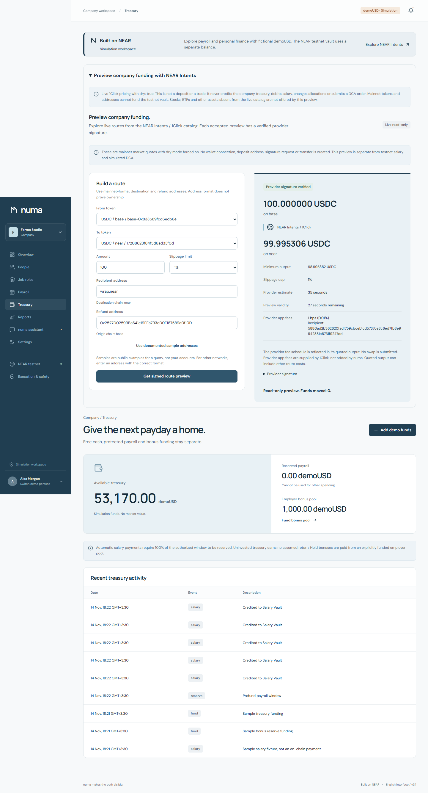
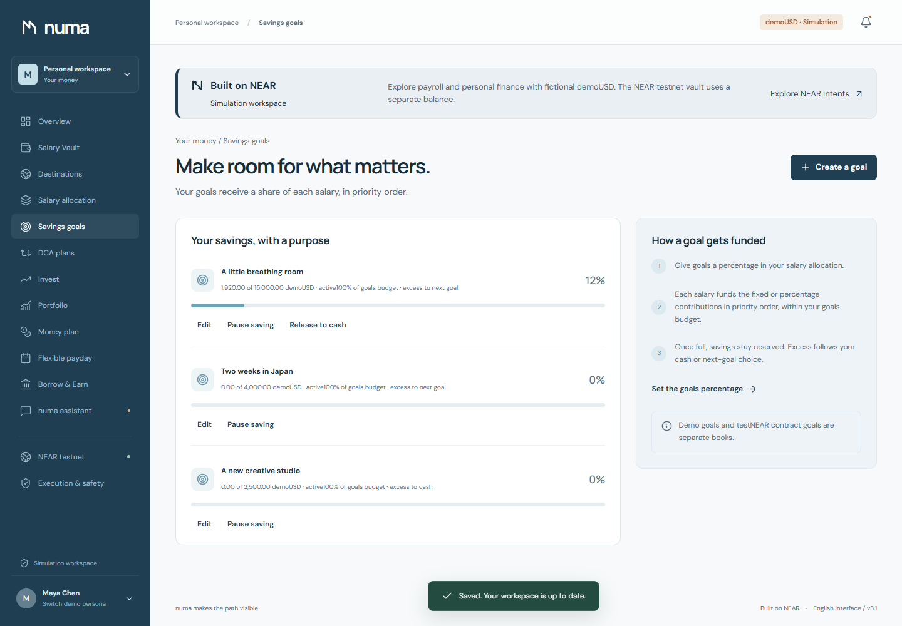

# numa: NEAR HACKATHON reviewer packet

Public repository: https://github.com/Huntrackers/numa

[Watch/download the recorded walkthrough](media/numa-demo.webm). The recording labels fictional
payroll separately from historical testnet receipts and the live mainnet-data-only dry quote.





This packet describes the implementation, not the original wish list. Historical Persian product
specifications are retained for provenance; the current status table in the root README and this
packet take precedence over a historical roadmap when describing what can actually execute.

## Product and track fit

A company defines job roles, employees and daily, weekly or monthly pay. It funds a limited payroll
window rather than handing its treasury to an agent. The employee sets savings rules, sees settled
pay and withdraws with their own NEAR identity. Company and employee views share an auditable
settlement trail. A separate site-operator console manages tenants without becoming the vault owner.

- Primary suggested track: `realworld` (payroll, employer treasury and employee savings).
- Additional suggested track: `security` (restricted execution key, shared policy evaluator,
  code pinning and wallet-bound human approvals).
- `business` is only a partial thematic fit. There is no claim of an autonomous revenue-generating
  business. No DeFi, private-AI or cross-chain-settlement track is claimed on the strength of previews.
- Track selection, team identity and the actual contest submission still require the owner's review.

## Reviewer quick start

Use Node 24 LTS. No private keys, paid API subscription, email service or model API is required.

```sh
npm ci
npm run build
npm run judge
```

Open http://127.0.0.1:4313/ for the English landing, `/login` for labelled sample personas and
`/trust` for public evidence. The review workspace uses a new temporary SQLite database and cannot
load the installation's `.env` or automated testnet signing key. Stop with Ctrl+C.

| Do this | Observe this | What it proves |
| --- | --- | --- |
| Company persona → People / Job roles | Employees, role pay and bulk-change preview | Local payroll management; sample data |
| Company → Prepare payroll → accelerated schedule → review → apply → Payroll | Five sample obligations become credited | Isolated scheduler/idempotency demonstration, fictional demoUSD |
| Company → Treasury → Preview company funding with NEAR Intents | Token catalog and signed output quote | Actual external `dry: true` market query; not treasury funding |
| Employee → Salary allocation / DCA / Invest / Destinations → expand preview | The same live read-only quote tool | Real market data is reachable from relevant product contexts |
| In a preview choose Base USDC → NEAR USDC, use sample addresses, request a quote | Verified provider signature, minimum output, fee breakdown and expiry | An actual 1Click response; no deposit or transfer |
| Edit a quoted amount | Previous result disappears | Stale route cannot be reused after editing |
| Employee → savings goal → salary allocation preview | Reviewable allocation to a goal | Personal planning; real settlement has its separate testnet view |
| Trust → Execution policy lab | One ALLOW and eight BLOCK scenarios | Deterministic shared policy evaluation, not a live exploit test |
| Trust → recorded receipts | Links to public NEAR testnet explorer | Historical real-chain evidence, not the fixture payroll above |
| Operator persona → NEAR testnet → back | Operator context remains selected | Operator navigation does not switch into a company |

Live 1Click/RPC requests can fail or be rate-limited. Such failures are visible; the app does not
replace unavailable market data with a made-up successful quote. The browser suite intercepts
provider responses for deterministic UI tests; `npm run intents:smoke` separately checks the real API.

## Run real testnet flows

Read the root README and [testnet operator runbook](OPERATIONS.md) before using a signing key.
Normal startup is `npm start` plus `npm run worker`, with `DEMO_ENABLED=false` and a private `.env`.
The interface is http://127.0.0.1:4310/. Use two identities to create a company and accept an
account-bound employee invitation. Native testNEAR, not demoUSD or mainnet stablecoins, funds the vault.

The public reviewed contract is
[`noma-vault-mw4ab6ev.testnet`](https://testnet.nearblocks.io/address/noma-vault-mw4ab6ev.testnet).
Reviewed code hash: `EM4NqrNoxHhDHQkPvVzxvwgrTkjt8mNjHduQqNUHoyvW`.
No private key for this deployment is distributed. Deploy your own reviewed vault to run your own
automated executor. A fresh-clone testnet reader must not expect to control somebody else's vault.

## Architecture and trust boundaries

```text
English React UI
  ├─ NEP-413 identity + exact human decision signatures
  ├─ wallet-signed testnet plans → NEAR vault → finalized receipt verification
  └─ same-origin API → 1Click catalog / forced dry quote / signature verification

Fastify API → tenant-scoped SQLite → journal, invitations, approvals and recovery
Worker → shared execution guard → restricted execute_due key → NEAR vault
Isolated review worker → independent demoUSD planning database (no chain signer)
```

| Layer | Implementation |
| --- | --- |
| Web | React 19, TypeScript, Vite; lazy-loaded pages and market-data workbench |
| API | Fastify, Zod validation, cookie sessions, CSRF/origin checks and rate limits |
| Storage | Node 24 SQLite; local tenant-scoped operational records and double-entry projection |
| Domain | Exact integer money, scheduling, allocation, forecasts and typed decisions |
| Contract | Rust / near-sdk 5.29.1; bounded authorizations, due-date checks, cash and savings |
| Automation | Worker leases and recovery; off-chain safety checks plus authoritative contract checks |
| Wallet | HOT near-connect with the bundled Meteor adapter; testnet verification paths |
| Market data | Official 1Click SDK signature verification; no JWT needed for dry previews |
| Optional AI | Local Ollama explanation; deterministic validated proposals still work without a model |

### NEAR's concrete role

Named accounts and NEP-413 bind users and exact decisions to identities. NEAR transactions register
companies and authorize contract actions. The vault reserves payroll, prevents duplicate credits,
allocates salary savings atomically and handles employee withdrawals. A function-call key limits
the scheduler to one receiver and `execute_due`. Finalized RPC receipts rebuild the local journal.
NEAR Intents / 1Click supplies genuine cross-chain route prices in preview mode only.

This release does not use Chain Signatures, NEAR AI Cloud, TEE inference, a mainnet lending protocol,
actual stock brokerage or a sponsored interactive-transaction relayer. Ordinary message signatures
cost no gas; employee transactions and scheduled execution still require testnet gas.

## Scope and honest limitations

- Real: testnet identity, company registration, payroll mandate, due-date execution, savings,
  claims/withdrawals, receipt reconciliation and signed sensitive local changes.
- Live read-only: catalog and signature-verified 1Click dry quotes in company funding, destinations,
  allocation, DCA and investing contexts. Mainnet-format sample addresses do not prove ownership.
- Simulated: DCA fills, shares/ETFs, yield, loans and early/late-pay economics in demoUSD. A quote does
  not turn these into real execution. Only assets present in the supported live catalog can be quoted.
- No guaranteed returns, insurance, promise of credit availability or legal tax/payroll compliance.
- On-chain payroll amounts and accounts are public. Keeping names off chain does not make payroll private.
- Local SQLite is a single-node operational store, not an HA production service.
- Contract map limits and migration constraints are documented in the root README. No unreviewed
  live upgrade is performed as part of publication.

## Verification and source map

```sh
npm run verify -- --browser --contract
npm run intents:smoke
```

Contract tests need Rust and platform C/C++ prerequisites; on Linux install a stable Rust toolchain,
Clang and build-essential. Browser tests need `npx playwright install --with-deps chromium` on Linux.
No test signs a mainnet transaction. Mutating optional testnet smoke scripts are separate operator tools.

- API: `apps/api/src/server.ts`, `live.ts`, `approvals.ts`, `intents.ts`.
- UI: `apps/web/src/App.tsx`, `IntentsPreview.tsx`, `pages/Trust.tsx`, `pages/Live.tsx`.
- Contract: `contracts/payroll-vault/src/lib.rs` and its tests.
- Automation: `apps/worker/src/`, `packages/near-adapter/src/safety.ts`.
- Evidence: [publication verification](VERIFICATION.md), previous testnet receipts in `docs/v3/public-evidence/`.
- Regressions: `tests/intents.test.ts`, `tests/e2e/intents-context.spec.ts`, onboarding,
  recovery, approvals, accounting, wallet and navigation suites.

## Provenance, licensing and contest gates

This dedicated numa workspace was developed in November 2026 with AI coding assistance. It had no
Git repository when publication preparation began; the initial public import is a source snapshot,
not reconstructed development commit history. It must not be presented as proof of historic commit
dates. Original specifications and dated verification reports document earlier local iterations.
Upstream libraries and adapter licenses are disclosed in `THIRD_PARTY_NOTICES.md`; original app code
uses MIT. The Meteor adapter has separate preserved GPL-3.0 notices and source materials.

The owner must disclose the exact name of another independent submitted project if any contributor
participates in it (Q-015). No shared contributor or submission is inferred from another local folder.

Official rules checked on 2026-11-14: [HACKATHON.md](https://nearhackathon.com/HACKATHON.md).
Testnet-only and local-only projects are eligible; local-only requires a video in the human's public
X post. Keep the repository public through judging. The published rules do not define numerical
scoring weights or a guaranteed passing score.

This repository is not an application receipt. See [submission checklist and drafts](SUBMISSION.md)
for the remaining human-owned steps. Never commit a payload containing contact or payout details.
